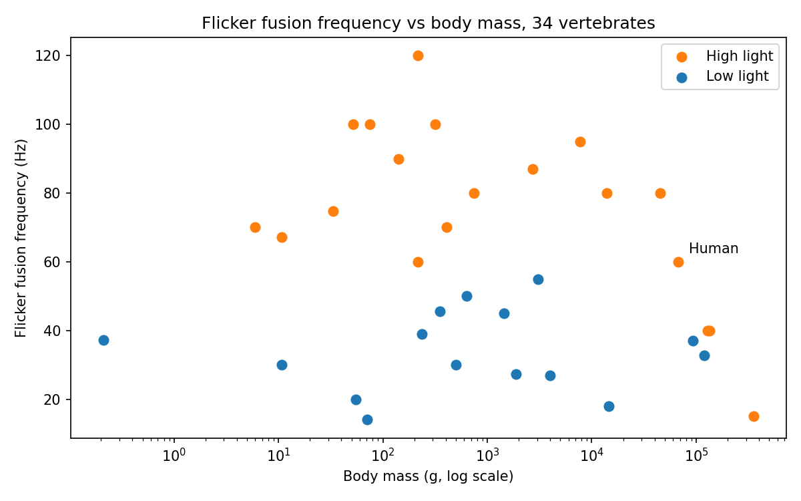

# Do smaller animals see "faster"?

Flicker fusion frequency (CFF) is the flicker rate at which a blinking light starts to look steady. A higher CFF means an animal can see faster changes. This project asks whether CFF changes with body mass across 34 vertebrate species, and whether light level matters.

## Data

- `data/raw/flicker_fusion_raw.csv`: one row per species, with CFF (Hz), body mass (g), light level (H = bright, L = low), how CFF was measured, and the original source for each number.
- Source of the table: Healy, K., McNally, L., Ruxton, G. D., Cooper, N. & Jackson, A. L. (2013). Metabolic rate and body size are linked with perception of temporal information. *Animal Behaviour* 86(4), 685-696, Table 1.
- The raw file is committed and is never edited by hand.

## How to run

You need Python 3 (tested with 3.14). From this folder (`Smilte_Tuskenaite`):

```bash
pip install -r requirements.txt
python scripts/plot_cff_vs_mass.py
python scripts/analyse_cff.py
```

The first script draws the plot. The second fits a straight line of CFF against log10(body mass) for each light level. Both write into `results/`. Paths are relative, so it works from any computer.

## Results



Fit of CFF against log10(body mass), from `results/fit_summary.csv`:

| Light level | Species | Change in CFF per 10x body mass | Correlation r |
|---|---|---|---|
| All | 34 | -3.65 Hz | -0.18 |
| Bright (H) | 19 | -9.31 Hz | -0.55 |
| Low (L) | 15 | +0.53 Hz | +0.07 |

In bright light, heavier animals tend to have a lower CFF. In low light there is no clear trend. Pooling all animals hides the trend, because light level separates the groups.

Limits: the groups are small, species are related by evolution so they are not independent points, and metabolic rate (which the paper also uses) is not included here. This suggests a pattern. It does not prove one.

## Use of AI assistance
I used Claude, an AI assistant, to help find the source paper, to draft the scripts and to explain the Git steps. 