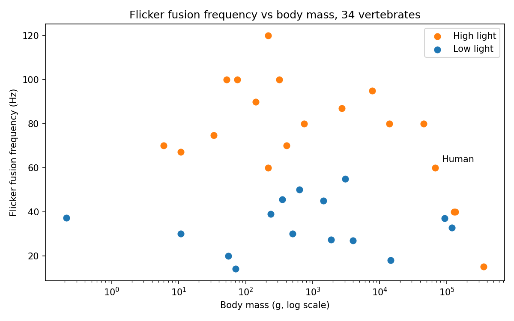

# Do smaller animals see "faster"?

Flicker fusion frequency (CFF) is the flicker rate at which a blinking light starts to look steady. A higher CFF means an animal can see faster changes. This project asks whether CFF changes with body mass across 34 vertebrate species, and whether light level matters.

## Data

- `data/raw/flicker_fusion_raw.csv`: one row per species, with CFF (Hz), body mass (g), light level (H = bright, L = low), how CFF was measured, and the original source for each number.
- Source of the table: Healy, K., McNally, L., Ruxton, G. D., Cooper, N. & Jackson, A. L. (2013). Metabolic rate and body size are linked with perception of temporal information. *Animal Behaviour* 86(4), 685-696, Table 1.
- The raw file is committed and is never edited by hand.

## How to run

You need Python 3 (tested with 3.14). From this folder (`Smilte_Tuskenaite`):

```bash
pip install -r requirements.txt
python scripts/run_all.py
```

`run_all.py` runs every step in order:

1. `analyse_cff.py` fits a straight line of CFF against log10(body mass) for each light level and writes `results/fit_summary.csv`.
2. `plot_cff_vs_mass.py` draws the plot and writes `results/cff_vs_mass.png`.
3. `build_site_data.py` combines the data and species names into `site/species_data.js` for the website.
4. `make_vision_images.py` makes the animal-view pictures used by the website's vision slider.

Each script can also be run on its own, for example `python scripts/analyse_cff.py`. Paths are relative, so it works from any computer.

To see the website, open `site/index.html` in a browser.

## Results



Fit of CFF against log10(body mass), from `results/fit_summary.csv`:

| Light level | Species | Change in CFF per 10x body mass | Correlation r |
|---|---|---|---|
| All | 34 | -3.65 Hz | -0.18 |
| Bright (H) | 19 | -9.31 Hz | -0.55 |
| Low (L) | 15 | +0.53 Hz | +0.07 |

In bright light, heavier animals tend to have a lower CFF. In low light there is no clear trend. Pooling all animals hides the trend, because light level separates the groups.

Limits: the groups are small, species are related by evolution so they are not independent points, and metabolic rate (which the paper also uses) is not included here. This suggests a pattern. It does not prove one.

## Use of AI assistance
I used Claude, an AI assistant, to help find the source paper, to draft the scripts and to explain the Git steps. 

## Photo credits
The animal photos are from Pexels ,free to use under their licences: https://www.pexels.com

## Vision viewer

The "How do they see it?" section on the website shows a meadow photo as a
human sees it and as eight animals might see it. The animal versions are
simple models, not exact pictures. Colour comes from how many cone types
the animal has, and blur comes from its visual acuity (cycles per degree;
humans resolve about 60). The numbers are in `data/vision_parameters.csv`.
The script `scripts/make_vision_images.py` turns the meadow photo
(`site/vision/scene.jpg`) into one picture per animal. It assumes the photo
covers 10 degrees of the view. Ultraviolet (chicken, pigeon) cannot be
shown on a screen. The gecko's acuity is a stand-in value from a wall lizard.

To remake the pictures:

    python scripts/make_vision_images.py

The meadow photo is from Pexels (https://www.pexels.com).

### Sources for the vision numbers

- Neitz J, Geist T, Jacobs GH (1989). Color vision in the dog. Visual Neuroscience 3(2):119-125.
- Daw NW, Pearlman AL (1969). Cat colour vision: one cone process or several? Journal of Physiology 201:745-764.
- Bowmaker JK, Knowles A (1977). The visual pigments and oil droplets of the chicken retina. Vision Research 17:755-764.
- Jarvis JR et al. (2009). Measuring and modelling the spatial contrast sensitivity of the chicken. Vision Research 49(11):1448-1454.
- Bowmaker JK et al. (1991). Photosensitive and photostable pigments in the retinae of Old World monkeys. Journal of Experimental Biology 156:1-19.
- Ver Hoeve JN et al. (1999). VEP and PERG acuity in anesthetized young adult rhesus monkeys. Visual Neuroscience 16(4):607-617.
- Peichl L, Behrmann G, Kroger RHH (2001). For whales and seals the ocean is not blue: a visual pigment loss in marine mammals. European Journal of Neuroscience.
- Hanke FD, Dehnhardt G (2009). Aerial visual acuity in harbor seals (as reported in a review of harbor seal senses).
- Blow NS (2004). Molecular evolution of visual pigments of the Tokay gecko and bluefin killifish. PhD dissertation, Syracuse University.
- Kawamoto A et al. (2025). How lacertids resolve spatial details: visual acuity in the common wall lizard. 
- Jacobs GH, Yolton RL (1969). Dichromacy in the ground squirrel. Nature 223:414-415.
- Jacobs GH et al. (2002). Ground squirrel retina and visual capacity (spatial acuity about 4 cycles/deg).
- Pigeon frontal-field acuity study (2005). Limits of visual acuity in the frontal field of the rock pigeon. Perception.
- Caves EM, Brandley NC, Johnsen S (2018). Visual acuity and the evolution of signals. Trends in Ecology and Evolution.